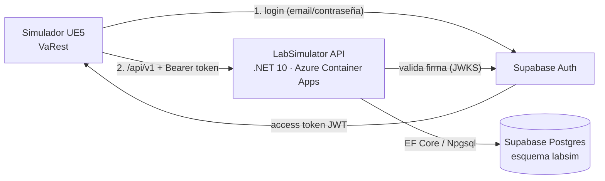

# LabSimulator API

API REST del simulador clínico **Virtual Hospital ITM** ([infusion-pump-simulator-ue5](https://github.com/JuanAvendan/infusion-pump-simulator-ue5)). Registra perfiles, sesiones de clase (*matches*) y los intentos de cada escenario, y calcula la nota en el servidor a partir de una rúbrica versionada.



- **Supabase** aporta dos cosas: autenticación (usuarios y contraseñas) y Postgres gestionado. El simulador **nunca** habla directo con la base de datos.
- **La API** concentra las reglas: quién puede crear o cerrar partidas, quién ve qué resultados y cómo se calcula la nota.

## Stack

| Área | Elección |
| --- | --- |
| Runtime | .NET 10 (LTS), ASP.NET Core con controladores |
| Datos | PostgreSQL 17 · EF Core 10 + Npgsql · migraciones como única fuente del esquema |
| Auth | Supabase Auth (JWT ES256 validado con JWKS) · roles `Student`, `Teacher`, `Admin` en la tabla `profiles` |
| Errores | `application/problem+json` (RFC 9457) |
| Docs | OpenAPI + Scalar en `/scalar` (solo en Development) |
| Tests | xUnit v3 + Testcontainers (Postgres real) |
| Entrega | Imagen Docker *chiseled* · GitHub Actions · Azure Container Apps |

## Endpoints (`/api/v1`)

| Método | Ruta | Quién | Qué hace |
| --- | --- | --- | --- |
| `GET` | `/me` | autenticado | Perfil propio (404 si aún no existe) |
| `PUT` | `/me` | autenticado | Crea el perfil (rol `Student`) o cambia el nombre |
| `GET` | `/profiles?role=` | Teacher, Admin | Lista paginada de perfiles |
| `PUT` | `/profiles/{id}/role` | Admin | Cambia el rol de un usuario |
| `GET` | `/scenarios`, `/scenarios/{code}` | registrado | Escenarios y su rúbrica (pasos y puntaje máximo) |
| `POST` | `/matches` | Teacher, Admin | Inicia una sesión de clase y devuelve su `id` |
| `GET` | `/matches/{id}` | host, participantes, Admin | Detalle con participantes |
| `POST` | `/matches/{id}/participants` | registrado | Unirse a una sesión abierta (idempotente) |
| `POST` | `/matches/{id}/end` | host, Admin | Cierra la sesión |
| `GET` | `/matches/{id}/attempts` | host, Admin | Resultados de la clase |
| `GET` | `/me/matches` | registrado | Historial de sesiones propias |
| `POST` | `/attempts` | registrado | Envía un intento; **el servidor calcula la nota** |
| `GET` | `/attempts/{id}` | dueño, host de la sesión, Admin | Detalle de un intento |
| `GET` | `/me/attempts?scenarioCode=` | registrado | Historial de intentos propios |

*Registrado* significa autenticado y con perfil creado mediante `PUT /me`. Las listas aceptan `page` y `pageSize` (máximo 100). También hay `GET /health/live` y `GET /health/ready`, ambos públicos.

## Desarrollo local

Requisitos: .NET SDK 10, Docker y un proyecto de Supabase (para los tokens).

```bash
docker compose up -d                                   # Postgres 17 en localhost:5433
dotnet tool restore                                    # dotnet-ef fijado en .config/dotnet-tools.json
dotnet ef database update -p src/LabSimulator.Api      # crea el esquema labsim
dotnet user-secrets set "Supabase:ProjectUrl" "https://<project-ref>.supabase.co" -p src/LabSimulator.Api
dotnet run --project src/LabSimulator.Api --launch-profile https   # https://localhost:7069/scalar
```

Tests (levantan su propio Postgres con Docker):

```bash
dotnet test
```

## Configuración

| Clave | Ejemplo | Dónde va |
| --- | --- | --- |
| `ConnectionStrings:LabSimulator` | `Host=...;Database=postgres;Username=...;Password=...;SSL Mode=Require` | user-secrets en local, **secret** en Azure |
| `Supabase:ProjectUrl` | `https://abcd1234.supabase.co` | user-secrets / variable de entorno |
| `Supabase:Audience` | `authenticated` (por defecto) | — |
| `RateLimiting:PermitsPerMinute` | `120` (por defecto, por usuario) | — |

En variables de entorno, el separador `:` se escribe como `__` (por ejemplo `ConnectionStrings__LabSimulator`). El repositorio no contiene ningún secreto.

## Cambios en el esquema

1. Modifica el dominio y su configuración en `Data/Configurations`.
2. `dotnet ef migrations add <Nombre> -p src/LabSimulator.Api -o Data/Migrations`
3. Revisa la migración generada y súbela en el mismo PR. La CI falla si el modelo cambia sin migración.

La rúbrica del escenario (`Data/ScenarioSeed.cs`) también se versiona con migraciones.

## Documentación

- [docs/supabase.md](docs/supabase.md): configurar Supabase, aplicar el esquema y crear el primer admin.
- [docs/azure-container-apps.md](docs/azure-container-apps.md): publicar la API.
- [docs/blueprint-migration.md](docs/blueprint-migration.md): qué cambiar en los Blueprints de VaRest.
